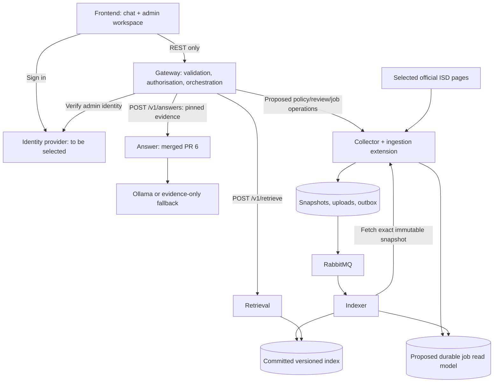

# Frontend and Gateway integration plan

Owner: Chukwuemeka Nwoke. Status: Gateway REST orchestration implemented and tested;
administrator authentication/ingestion and real index storage remain separate work.

## Architecture

The Gateway is the only browser backend. Service credentials, internal addresses,
database access and broker connections never belong in frontend code. Each
question carries one request ID and one pinned evidence generation.

## Where frontend information comes from

| Screen information | Repository source / proposed producer | How it reaches the frontend |
|---|---|---|
| Brand, greeting, layout and topic prompts | `frontend/dist/` | Static assets; prompts are suggestions, not policy claims |
| Explanation and checklist | Answer Service, reviewed against PR #6 | Gateway question response |
| Official URLs, excerpts and source versions | Collector snapshots → indexer → Retrieval | Gateway preserves evidence, validates returned citations |
| Index generation and collection timestamp | Committed repository snapshot | Gateway question response; proposed `/v1/collection` |
| Candidate source list/topics | `data/sources_manifest_v1.json` | Build/collection input; not proof that sources were fetched/indexed |
| Expected evidence and test scenarios | `data/qa_gate_10_v1.json`, `tests/` | Evaluation only; never feed expected answers into user responses |
| Admin identity and role | Selected identity provider | Gateway verifies token; proposed `/v1/admin/session` |
| Upload/review/indexing progress | Proposed ingestion job store updated by collector/indexer | Gateway `/v1/admin/jobs/{job_id}` |
| Model name, prompt version and fallback | Answer response | Gateway response; expose accurately without fake model version badges |

The source manifest explicitly records a selection gate, not a completed live
pipeline. Never display its generated/review date as current collection freshness.
`effective_date`, source check time and index timestamp have different meanings;
`last_success_at` semantics still need agreement with the storage owners.

## Exact question sequence

1. Browser posts `{question}` to Gateway `/v1/questions`, with an optional
   `X-Request-ID`. Gateway validates or generates the ID.
2. Gateway calls Retrieval `/v1/retrieve` with that ID in the body and header,
   `top_k=5` and no explicit index version for a fresh question.
3. Retrieval pins one immutable committed version. No matches is HTTP 200 with
   empty passages; a missing index is an availability error, not no evidence.
4. Gateway maps evidence using `contracts/INTERFACES.md` and calls Answer
   `/v1/answers`. No body request ID or unknown fields are sent. Empty evidence
   can be forwarded without calling a model; Answer already supports this.
5. Validate the Answer envelope and supplied-source membership. Return 502
   `upstream_unavailable` for unreachable services and 504 `upstream_timeout`
   for expired calls; invalid upstream payloads map to 502 with a safe message.
   Model failure handled by Answer may still be HTTP 200 `degraded`.
6. Browser renders `answered`, `insufficient_evidence`, `degraded` and `stub`
   distinctly; it does not convert an error into policy advice.

Budget proposal: Gateway total 30 seconds, Retrieval up to 3 seconds, Answer up
to 23 seconds, reserving validation/transport overhead. Answer's current model
timeout defaults to 20 seconds. Clamp downstream deadlines to the remaining
total budget and use an actual end-to-end deadline, not only socket timeouts.
The repository frontend uses a 35-second abort for this budget. No automatic
generation retry is performed. Confirm any changes to the model deadline with Jordan.

## Administration extension (proposal)

Choose an OIDC identity provider. Public questions do not require admin identity.
The Gateway validates token issuer/audience/signature/expiry and policy_admin
role. No password collection or client-side flag grants backend permissions.
The current frontend sign-in and upload workspace are previews only.

Submit a nonempty PDF/TXT/HTML of at most 10 MiB, title, official source URL and
optional effective date using multipart `/v1/admin/policies`. Use an opaque
`Idempotency-Key`; retries with the same administrator, key and content return
the same durable job for at least 24 hours. Reusing a key with changed content
returns 409. The Gateway uses server-side service identity downstream and sets
the verified actor itself; browser-supplied actor headers are not trusted.

Proposed lifecycle: pending_review → queued → processing → indexed, with failed
or rejected terminal states. Approval is an explicit authenticated action; no
automatic publication. Rejected is reserved until a rejection operation is
agreed; no reject button is promised by the current contracts. Review must
verify document authenticity and extracted content. An official URL entered by
an administrator is not proof that an uploaded file is official guidance.

Approval creates the immutable snapshot and existing document.updated outbox
record transactionally. Do not change the existing event schema for job metadata.
Store job/snapshot/source-version correlation separately, and arrange an
indexer-to-job update boundary with Kezhen before implementing status polling.
Only mark indexed after atomic generation activation; eventual status updates
may lag, but must never announce an uncommitted generation. Poll every 2 seconds
with backoff, stop on terminal status, and retain failed jobs for inspection.

This expands the initial public-source-only scope. Keep uploads limited to
official policy materials; personal immigration documents remain out of scope.

## Deployment and Gateway ownership

Serve frontend statically; prefer a same-origin reverse proxy to Gateway.
The current preview allows a manually configured Gateway base URL. For separate
origins configure an exact CORS allowlist, POST/GET/OPTIONS and the required
headers: Content-Type, X-Request-ID, Authorization, Idempotency-Key. Expose
X-Request-ID and Location. CORS does not replace authentication. Do not use a
wildcard origin with credentials. Keep metrics/internal APIs off public routing.

The Gateway owner implements HTTP client lifecycle, tracing, deadlines,
canonical evidence validation, public error mapping, admin access checks,
upload size limits and proxying. Collector owns extraction/snapshots/outbox;
Indexer owns chunking/publication; Answer owns generation/fallback semantics.
Do not proxy arbitrary user-specified URLs or log raw tokens/personal documents.

## Delivery checklist

- Frontend source copied into `frontend/`; no Site Git metadata or hosting identity.
- Gateway public question flow now orchestrates REST; proposed admin routes remain unimplemented.
- OpenAPI documents validate and relative references resolve.
- Gateway REST clients preserve evidence and validate the merged Answer contract.
- Test successful answers, model refusal/fallback, no matches, missing index,
  malformed upstream payloads, forged citations and version mismatch.
- Test CORS, request-ID propagation and browser/Gateway deadline alignment.
- Before enabling admin UI: verify 401/403, role enforcement, MIME/size checks,
  idempotency, review approval, duplicate events and failure/status recovery.
- Do not claim end-to-end RAG, authenticated uploads or production readiness from
  static frontend checks or contract validation alone.
